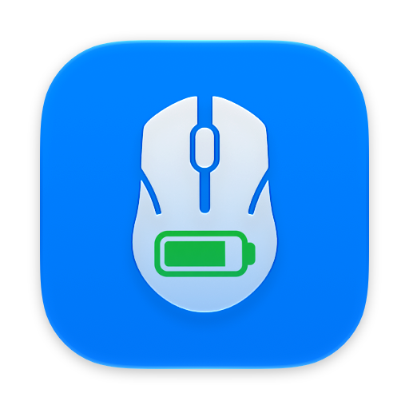

<p align="center">
  
</p>

<h1 align="center">XliteBattery</h1>

<p align="center">
  Battery level and settings of the Pulsar Xlite v4 Wireless, right in the macOS menu bar.
</p>

<p align="center">
  <a href="https://github.com/AnyByte/pulsar-xlite-battery/releases/latest"></a>
  <a href="https://github.com/AnyByte/pulsar-xlite-battery/actions/workflows/release.yml"></a>
  <a href="https://github.com/AnyByte/pulsar-xlite-battery/releases"></a>
  
  
  
</p>

---

XliteBattery is a small menu bar app for the **Pulsar Xlite v4 Wireless** on the stock
1K dongle (`3710:5402`). It shows the charge next to a mouse icon and lets you change the
mouse settings without the vendor software.

> [!IMPORTANT]
> Only the Xlite v4 with the 1K dongle is tested and supported. Other mice and the 4K/8K
> dongles are not supported, and support for them is not planned.

## ✨ Features

| | |
|---|---|
| 🔋 **Battery in the menu bar** | Charge level with a charging mark. The icon appears only while the dongle is plugged in and the mouse is awake. |
| 📶 **Live signal quality** | Link quality in the menu, updated every second while the menu is open. |
| 🖱️ **Mouse settings** | DPI, polling rate, lift-off distance, motion sync, angle snapping, ripple control, debounce, sleep timer, power-saving threshold. Every change is read back and verified. |
| 💡 **Side LED** | Off, steady or breathing, brightness down to barely visible, and an optional mode where the LED colour shows the charge from red to green. The mouse resets brightness after every sleep; the app puts yours back as soon as it wakes up. |
| 🌍 **English and Russian** | Follows the system language by default (Russian if the system is Russian, English otherwise); switch it in the menu under Language. |
| ⌨️ **CLI** | `--once`, `--settings` and `--set key=value` for scripts and debugging. |

## 📦 Install

1. Download `XliteBattery-<version>.zip` from the
   [latest release](https://github.com/AnyByte/pulsar-xlite-battery/releases/latest).
2. Unzip it and move `XliteBattery.app` to `/Applications`.
3. The app is not notarized, so remove the quarantine flag once before the first launch:

   ```sh
   xattr -dr com.apple.quarantine /Applications/XliteBattery.app
   ```

4. To start it at login, add it in **System Settings → General → Login Items**.

> [!NOTE]
> On the first launch macOS asks for **Input Monitoring**: the dongle sends link and signal
> events through its input interface. Battery and settings work without it; signal quality
> and instant wake/sleep detection need it.

## 🛠️ Build from source

Needs the Xcode command line tools (`xcode-select --install`).

```sh
./build.sh      # build.noindex/XliteBattery.app, universal arm64 + x86_64
./install.sh    # build, copy to ~/Applications, start at login via a LaunchAgent
```

The icon is an Icon Composer file (`icon/AppIcon.icon`); `icon/compile.sh` compiles it
with Xcode 26+ and the output is committed, so builds do not need a new Xcode.

## ⌨️ Command line

```sh
XliteBattery.app/Contents/MacOS/XliteBattery --once            # battery level
XliteBattery.app/Contents/MacOS/XliteBattery --settings        # dump all settings
XliteBattery.app/Contents/MacOS/XliteBattery --set dpi=1600    # write and verify
```

Keys for `--set`: `dpi`, `polling`, `lod`, `angle_snap`, `ripple`, `motion_sync`,
`debounce`, `sleep`, `low_power`, `led`, `led_brightness`, `led_charge`.

## 🚀 Releases

Pushing a tag `v*` runs the GitHub Actions workflow, which builds the universal app and
attaches the zip to a new release:

```sh
git tag v1.2.3 && git push origin v1.2.3
```

## 🔌 Protocol

The dongle speaks the Fusion2/Sonix protocol: 64-byte feature reports without a report ID
on USB interface 3. The register map comes from
[pulsar-mouse-linux](https://github.com/packerlschupfer/pulsar-mouse-linux) and
[mousectl](https://github.com/D3m0nZOnFire/mousectl).

> [!WARNING]
> Do not send other vendors' frames to the dongle: the 17-byte X2 V2 protocol locks it up
> until it is replugged.

---

<p align="center"><sub>Not affiliated with Pulsar Gaming Gears.</sub></p>
